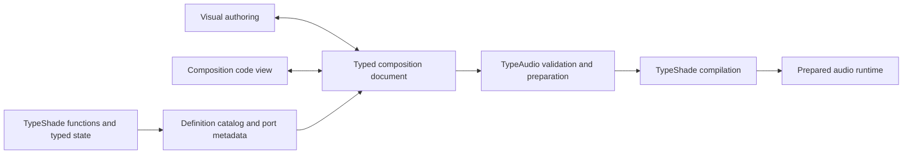

# Function and visual graph authoring

Status: owner-approved implementation direction, recorded 2026-11-07.
E2a's first CPU engine profile is implemented in [PR #30](https://github.com/typeshade/typeaudio/pull/30).
Read [the delivered API and limits](../function-graphs.md) and [verification receipt](function-graph-verification.json).
E2b is implemented in Web PR #47. The [E2c composition continuation](composition-editing.md) adds source projection and connected-input rename.
Reusable subgraph packaging, E2d events and E2e native/Unreal work remain.
Owner direction: accept normal TypeShade functions and support Blueprint-style visual authoring as a first-class workflow.
The code editor and node editor must compose the same processing definitions.
This refines D05 and the editable agent-project milestone, E1.

## Baseline and observed mismatch

The engine baseline is `86560f83a92ff8374346157000b8a467daa39aab`.
The compiler pin is `87af4eb0d9d15f02b66b8341b72cab0944290472`.
The Web clarification is `63216066bb8a2109d0c7e5b6286500b04ab39cb0`, in Web PR #47.
The recovery base for this proposal is `6b0b1779d1bf13a17f0bf267dd0f470b62a45bcd`.

The preserved legacy `SoundGraph` has fixed node kinds, index-based values, one output and input links containing only node IDs.
`validateCode.ts` rejects function declarations and non-whitelisted calls before TypeShade compilation.
`generateGraphKernel.ts` accepts one generated function and rejects nested generated calls.
These are adapter restrictions, not a requirement of TypeShade function authoring.
The existing engine `Voice.tick()` already composes oscillator and filter methods in its bank renderer.
The design in `docs/vision.md` already describes functions and typed DSP state.

The original Web `63216066` checkpoint corrected selection and binding explanations within the old contract.
Later commits in Web PR #47 implement function instances and the composition workflow. Use the continuation records for current status.

## Authoring model

TypeShade source defines processing. Visual composition defines instances, connections and exposed controls.
Both are first-class parts of one versioned project. Neither editor has a second, independent execution implementation.
The previous description of code as the only authoring surface was incomplete for this workflow.

This composition document is an audio-domain contract. It is not another shader language or general-purpose compiler IR.
TypeShade owns parsing, type checking, symbol resolution, lowering and general code generation.
TypeAudio owns signal rates, channels, units, instance identity, state lifetime and scheduling.
Web owns visual interaction, selection, drafts, history and inspection.

Source modules own function bodies. The composition owns call instances and connections.
A function body can remain ordinary TypeShade code while its call is a visual node.
Library functions and user functions use the same definition contract and compiler path.
Subgraphs expose typed interfaces and can become reusable definitions.
Built-in DSP should not require a separate implementation for code and visual use.

## Definitions, instances and pins

| Item | Required meaning |
| --- | --- |
| Definition identity | Stable ID, module and export reference, source revision/hash, and interface version. |
| Language signature | Parameter and result types obtained from TypeShade analysis, with original source ranges. |
| Pin identity | Stable port ID distinct from its display label and current position. |
| Audio metadata | Event, control or audio role; update rate; channel count; units; defaults and explicit conversions. |
| Control presentation | Optional range, scale, step, label and grouping. It does not alter the function's arithmetic. |
| Instance identity | Stable call-site ID with its own bindings and lifecycle. A duplicate gets a new identity. |
| State schema | Typed state and initialization/reset rules, with a schema version for compatibility checks. |
| Connection | Source instance/port and destination instance/port, not display names or array positions. |

A scalar `f32` alone cannot distinguish hertz, gain, audio samples and a block-rate control.
Use TypeAudio descriptors alongside the ordinary TypeShade signature for these meanings.
Do not infer units from parameter names. Do not invent new TypeShade syntax for slider configuration.
The implemented descriptor spelling is documented in [the function API](../function-graphs.md); this table describes the broader design.

A pure function such as `gain(signal: f32, level: f32): f32` can expose two inputs and one result.
Its descriptor identifies signal and level roles. A disconnected level input can show an editable constant.
Connecting a control source replaces that constant binding, with a visible type and rate check.
Struct results can expose named output fields where the execution contract supports them.

Stateful functions can use explicit typed state; existing TypeShade classes can expose their state and processing method.
Each stateful call instance, within each voice, owns separate persistent state.
Duplicating a filter must not make two nodes share delay history accidentally.
User-visible names such as `cutoff` and `resonance` remain meaningful; positional `p0`/`state0` slots are not the public authoring interface.
The runtime can still use compact numeric storage internally.

## Two execution flows

Blueprint-style interaction is a useful reference for gameplay events and controls.
MetaSounds-style dataflow is a closer reference for continuous sound processing.
TypeAudio needs both execution contracts; these references do not imply Unreal compatibility.

| Flow | Example | Execution rule |
| --- | --- | --- |
| Event/control | Collision → material choice → set intensity → trigger sound | Explicit event ordering and audio-frame timestamps; bounded queues and late-event policy. |
| Audio | Excitation → resonator → filter → spatial send → output | Prepared synchronous processing, with declared sample/block rates and persistent per-instance state. |

A trigger is an event, not a float sampled once per render frame.
A continuous audio signal does not require a gameplay execution wire to advance each sample.
Pin shapes, text and connection rules must distinguish these meanings; color alone is insufficient.
Cross-rate operations such as smoothing, sample-and-hold or event-to-envelope conversion must be explicit or clearly reported.

The initial audio graph rejects algebraic cycles. Later feedback requires an explicit delay and validated state semantics.
Event ordering must be deterministic. A generic event graph is not permission for unbounded work on the audio thread.
R1 owns the full scheduling and overload contract; E2 must expose a compatible boundary rather than invent another clock.

## Editing flow

1. Create a reusable sound function or choose one from the catalog.
2. Add an instance visually, or reference it in the supported composition code view.
3. Connect compatible pins and expose selected constants as named controls.
4. Open a node to edit its TypeShade function or enter its subgraph.
5. Preview the prepared candidate while retaining the last valid applied sound.
6. Apply the complete validated revision and preserve compatible live state.
7. Save modules, composition, control bindings and drafts together.

The catalog filters additions by the selected pin's type and rate.
Connecting, disconnecting, adding and grouping must have pointer, keyboard and context-menu operations.
Invalid connections explain the type, channel or rate mismatch at the affected pins.
Each operation is one Undo transaction shared across code, graph and inspector views.
Rename and pin reorder preserve identity; incompatible signature edits show affected connections before applying.
Navigation from a node reaches its function definition and original diagnostic range.
Live inspection can show values, waveforms and execution status without requiring a separate code implementation.

Code remains a full TypeShade module for function authoring, including supported helpers and imports.
The visual canvas does not expand every statement inside a function into nodes.
Structured composition code can map calls and bindings to the composition document.
Loops, conditionals or other bodies that lack a visual composition mapping remain intact inside a function node.
Do not erase unsupported source, silently flatten it, or claim an arbitrary TypeScript round trip.
Do not restrict all function bodies merely to make visual composition easier.

Source projection must preserve unrelated modules, source ranges and comments.
Unresolved or invalid drafts stay saved while the last valid revision remains applied.
Concurrent code and graph edits require revision checks; a late compilation must not restore old values.
Generated engine kernels are inspection artifacts, not another editable source of truth.

## Real-time preparation

Function composition does not itself require an interpreter or a function object per sample.
Compile, specialize or inline where the actual compiler supports it, then inspect the produced artifact.
Ordinary helper calls are acceptable when the resulting execution satisfies the measured profile.
Do not replace the current blanket function ban with an unverified claim of allocation-free execution.

Compilation, module resolution, state allocation and buffer sizing run before audio processing.
The audio callback executes prepared work without compilation, network access, GPU waits or unbounded allocation.
Typed state needs a verified synchronous calling convention; object layout and `inout` code generation require tests.
Compatible parameter edits preserve state. Incompatible source/state changes use an explicit migration or reset with a transition policy.
The last valid artifact stays active if preparation fails or an older revision completes late.
Report execution tier, rejected operations and measured limits at their source locations.

Proposal 0122 remains an unresolved public synchronous CPU artifact contract.
E2 may retain a measured adapter while that proposal is pending; it must document the deviation.
No compiler pin move or new compiler feature is implied by this design.
The original SwiftShader measurement boundary still applies.

## Host and Unreal boundary

Keep definition metadata, composition validation, state layout and preparation independent of DOM, React and Web Audio.
A host adapter supplies buffers, sample rate, frame clock, events, parameter updates and instance lifecycle.
The Web adapter executes through its prepared AudioWorklet path.
A future Unreal adapter can expose Start/Stop, named controls and events to Blueprint while the audio renderer processes DSP.
An optional MetaSounds-facing adapter would need an explicit mapping for audio/control pins and channel layouts.

No Unreal plugin, native binary, C++ backend or cross-host artifact compatibility exists as a result of this document.
Native target support, packaging, buffer ABI and ownership need a separate implementation and feasibility check.
The same project semantics can be shared before identical executable artifacts are possible.

## Migration and agent handoff

Keep existing source projects, applied code, drafts, seeds, connections, layout and control values recoverable.
Import old sample bodies through an explicit compatibility definition with their current bindings.
Do not silently reinterpret their state or parameter indices.
Use a versioned migration with fixtures for every current study project and representative standalone graphs.
Keep the previous document until migration and validation succeed.

An agent delivers source modules, stable definition references, composition, parameter metadata and a versioned manifest.
The manifest identifies the engine/compiler pair and the prepared artifact's source revision.
The user can open that project, inspect nodes, edit function code, reconnect ports and reproduce the result without the agent.
Render caches are derived artifacts. They never replace editable source or validate stale revisions.

## Delivery slices and acceptance

| Item | Implementation | Required evidence |
| --- | --- | --- |
| E2a | Implemented first CPU profile: engine-owned descriptors and full-module function preparation, PR #30 | TypeShade helper/import/type diagnostics; stable typed pins; independent typed state; synchronous PCM and actual worklet parity; nested writeback reuse and bounded loop faults. |
| E2b | Implemented reusable function instances in Web #47 | Create/connect/expose controls without code; open a function; duplicate with isolated state; contextual search and Undo. |
| E2c | Implemented static composition editing, connected-input rename and project version 4; subgraphs remain | Changes visible in both views; stable pin IDs; source preservation; invalid-draft recovery; old projects reopen without resets. |
| E2d | Event/control integration through the R1 host contract | Deterministic trigger/parameter timing, late/overflow cases and host-independent source replay. |
| E2e | Optional Unreal integration feasibility | Chosen native execution target, buffer/lifecycle contract and a minimal host test before plugin promises. |

The first demonstration is an agent-authored impact: excitation → resonator → gain → output.
Open it visually, change a named control, edit the resonator function, duplicate a stateful instance and save/reopen the project.
Equivalent code and visual compositions must produce matching PCM under the same backend and configuration.
Run migration, state isolation, source-location, Undo/Redo and stale-result tests before adoption.
Measure actual callback behavior separately from host CPU correctness and from listening quality.
The impact source and engine execution are implemented in `fixtures/function-graph/impact.json`.
Visual editing and project migration are implemented in Web #47.
Read [the composition continuation](composition-editing.md) for cross-view verification and limits.
