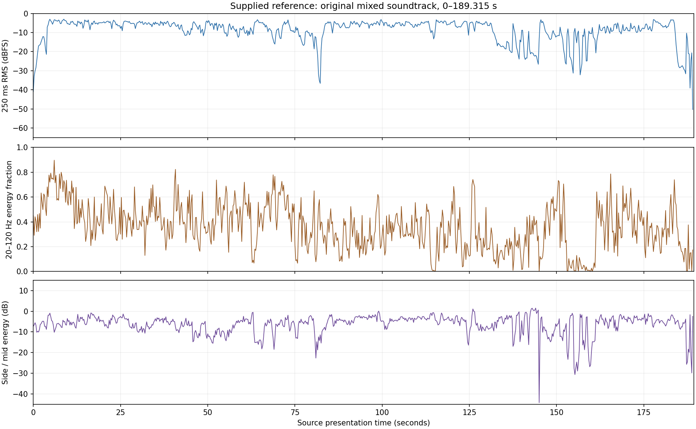

# Dramatic, visual and signal analysis

The strongest design direction is a progression from readable magical materials to an attack with no visible projectile, then a sustained release and recovery.
The design must preserve differences in causality, scale and attention across that progression.
The largest image does not require every supporting layer to become equally prominent.

This report uses 514 distinct inspected frames, including adjacent-frame checks, and measurements of the supplied mixed soundtrack.
It does not claim an auditory review of the original or the previous synthesized mix.
[Evidence](evidence.json), [spotting data](spotting.json) and [timing corrections](findings.md) retain the basis and limits.

## The dramatic structure

The duel first establishes recognizable attack and defence mechanisms.
The red material is contained, mobile and disruptive. Violet branches make energy appear unstable and distributed.
The later geometric and beam exchanges increase complexity while the characters retain deliberate control.
Fern's intervention then creates an apparent advantage.
The wounded clone remains active, and its next attack defeats the viewer's expectation of a visible magical preparation.
The close-range counterattack restores control. Dissolution and reassurance complete the scene's emotional recovery.

Character identity follows the supplied title and scene continuity.
Use stable caster, defender, clone and Fern event identities when authoring.
Lighting makes the pale-haired figures look different across shots; costume brightness alone cannot determine the emitter.

| Approximate source region | Visible evidence | Dramatic function | Proposed sound hierarchy |
| --- | --- | --- | --- |
| 0–3.9 s | Opening fade, dust and damaged stone | Establish an existing aftermath | Hall continuity and remote debris; no mandatory new explosion at zero. |
| 3.9–30 s | Red formation, orbit, stone contacts, cracked enclosure and radial release | Establish a dangerous material and a readable counter | Orb body and motion first; contact and defensive dispersion remain distinct. |
| 30–43.3 s | Human close-up, displaced slabs, heavy landing and dust | Re-establish scale and physical mass | Small cloth detail, slow structural strain, then a layered contact. |
| 44–60 s | Violet sparks, branching discharge, geometric defence and release | Increase instability and pressure | Irregular arcs, shield resistance and a clear release envelope. |
| 62.3–82.5 s | Blue response, debris, reactions and explanation | Restore tactical readability | Precise launches and remote continuations, with space for speech. |
| 82.5–119 s | Coloured construction, large rings, dark wedges and shield fracture | Show changing methods and sustained resistance | A few dominant motifs; distinct shield stress and counterattack. |
| 119–136.5 s | Fern aims and fires; the wounded clone emerges through dust | Create apparent advantage and uncertainty | Articulated salvo, decreasing battle density, boot and residual shield detail. |
| 136.5–145.187 s | Reactions, the clone's held gaze and Fern's eyes | Prepare surprise through uncertainty | A deliberate reduction of selected layers without an attack-specific warning. |
| 145.187–149.7 s | Sudden bodily response, travel, column contact and structural damage | Break the apparent advantage | Short force onset, separate body contact, then stone break and settling. |
| 149.7–173 s | Subjective eyelid views, hand detail, distance and recognition | Make the consequence and realization register | Restrained perspective change, human detail and an audible sense of distance. |
| 173–177.552 s | Frieren appears behind the clone; a small staff light gathers | Reveal the reversal | Close handling and compact preparation; reserve the large expansion. |
| 177.552–183.767 s | Graphic flash, established vertical beam and whiteout | Deliver sustained release | Defined initiation, evolving body, selected debris, then decay. |
| 183.767–189.315 s | Clone dissolution, reassurance and fade | Resolve the entity and return to human scale | Sparse magical decay and quiet hall continuity through the complete closing shot. |

These are editorial regions, not a verified shot-boundary list.
The 41 entries in [spotting.csv](spotting.csv) divide them into practical design units.
Each entry separates its observation, proposed source treatment, spatial intent and supporting frames.

## Three sequences that determine whether the design works

### Red material: 20–30 seconds

The visible path connects nearby stone contacts, a fast crossing, a contained cracked shell and a radial release.
The sound needs continuity through those changes, so the viewer can recognize one causal process.
Give the travelling material a stable body. Change its edge, apparent distance and modulation as the motion changes.
At 25.692333 seconds the shell begins to fracture. The larger radial release begins at 25.77575 seconds.
The subsequent pale geometric dispersion should have an identifiable response and a thinner decay.

An effective review asks whether the listener can distinguish travel, containment, rupture and defensive resolution.
Adding several simultaneous low-frequency impacts would obscure that sequence.
Debris should follow selected visible contacts and later settling, not a uniformly random schedule across the whole passage.

### Unseen force: 136.5–149.7 seconds

The picture establishes expectation through reaction shots before an abrupt bodily change.
The first hair displacement occurs at 145.186708 seconds. Column contact dust appears at 145.937458 seconds.
Their separation is 18 source frames, or 0.75075 seconds.
This interval measures the edited picture sequence. It is not acoustic propagation time or a measured projectile velocity.

Use four separately editable phases: initial pressure, bodily displacement, body/column contact, and architectural aftermath.
Give the initial event a compact identity without a long directional precharge.
The later collision needs bodily mass before the larger stone fracture and scattered debris.
The subsequent subjective views justify testing a narrower or less reverberant perspective.
They do not establish a medical hearing effect; tinnitus is an optional creative hypothesis requiring review.

The key review asks whether the event still surprises, whether the body has weight, and whether the second contact remains clearly separate.
Do not use a reaction at the face as proof that an unseen projectile has a measurable world-space origin.

### Final release and recovery: 173–189.315 seconds

The preparation remains visually small and close to the characters.
The graphic flash starts at 177.552375 seconds. The established vertical beam appears 0.25025 seconds later.
The beam persists through changes in camera framing, rings, debris and the upper-space view.
Treat it as one continuing source state with changing perspective.
Do not trigger another full attack simply because the shot changes.

The image blooms toward white, then reveals tapering dark legs and particles around 184 seconds.
That process calls for dissolution, not an ordinary fabric-settling cue.
The final reassurance shot restores bodily scale and contains the closing spoken line.
Retain its fade beyond 188 seconds. The proposed exclusive study endpoint is 189.314625 seconds.

The review asks whether the final event has sustained scale, whether its decay leaves room for dissolution, and whether the ending feels complete.
A very loud flash followed by an unchanged noise bed would not express those phases.

## Spatial reading of the picture

The scene shows a large circular stone chamber, tall columns, an upper gallery, a high upper space and extensive debris.
This supports a design with strong early reflections, a persistent room identity and different near/far perspectives.
It does not reveal dimensions, absorption coefficients, an impulse response or a measured reverberation time.

Keep three coordinate descriptions separate:

1. Screen position: an observed image-space location or movement.
2. Authored world position: a chosen geometry consistent enough for the scene and explicitly marked as invented.
3. Listening perspective: camera-relative or character-relative, including transitions between shots.

A source behind the clone is not necessarily behind the person wearing headphones.
A high object in the image does not prove a perceptual elevation cue in a stereo render.
Keep direct motion, early reflections and diffuse room energy separate during review.
Carry the room tail across edits, while changing foreground perspective deliberately.

Use stone surfaces and large intact structures as candidate acoustic boundaries.
Dust clouds alone do not justify modelling a solid occluding wall.
If a filtered subjective perspective follows a dusty cut, label that filter as an editorial choice.
No metric room reconstruction or ray-traced acoustic validation was performed in this task.

## What the original mixed-track measurements show

The measured range is 0–189.314625 seconds from the supplied file.
The decode produced 8,348,775 stereo frames at 44,100 Hz, within one sample of the requested duration.
The scripts explicitly trim the signal before loudness analysis.

| Measure | Observed value | Interpretation |
| --- | --- | --- |
| Integrated loudness | −4.23 LUFS | Level of this downloaded mixed reference, not a delivery target. |
| True peak | +3.54 dBTP | Floating decode overshoot; downstream clipping depends on playback handling. |
| Sample peak | +3.34 dBFS | Decoded floating samples exceed nominal full scale. |
| Loudness range | 7.2 LU | Gated mixed-program measure, not the range of an isolated effect. |
| Samples at or above nominal full scale | 366,369 across both channels | A reason to control reference audition gain; not a count of audible defects. |

The reference should not set the new mix's master level by imitation.
Reduce reference audition gain and compare candidates at matched listening level.
Do not normalize every cue separately; that would change the intended internal dynamics.
YouTube playback normalization and its live synchronization offset were not measured here.

The 250 ms RMS windows show a pronounced relative reduction before the unseen attack.
The 136.5–145.18 second region has a median window RMS of −20.39 dBFS.
The final-discharge region has a median of −5.09 dBFS, about 15.3 dB higher by this metric.
This supports preserving a strong level contrast, but does not identify whether music, dialogue or effects caused it.
The closing region has a median of −26.30 dBFS and includes the fade.

The plotted energy fractions and stereo relationships are descriptive measurements.
They cannot establish height, HRTF quality, a specific sound material or creative success.
The original track is a composite; muting it removes dialogue and music as well as effects.
No source separation or auditory evaluation is claimed.

## Production consequences

Start creative validation with the three passages above, using a small number of candidates for each material.
Keep timing, source design and mix treatment as separate revision dimensions.
Lock the visually verified anchors before evaluating a material change.
Preserve the final scene fade and add dissolution and grounded movement to the cue inventory.
Keep uncertain physical launch times explicitly unresolved when a cut reveals an already active beam.

Use [the design brief](sound-design-brief.md) for procedural parameters, spatial routing, review questions and engine requirements.
The current result is an analysis package. It is not a selected soundtrack or a shipped spatial-audio feature.
